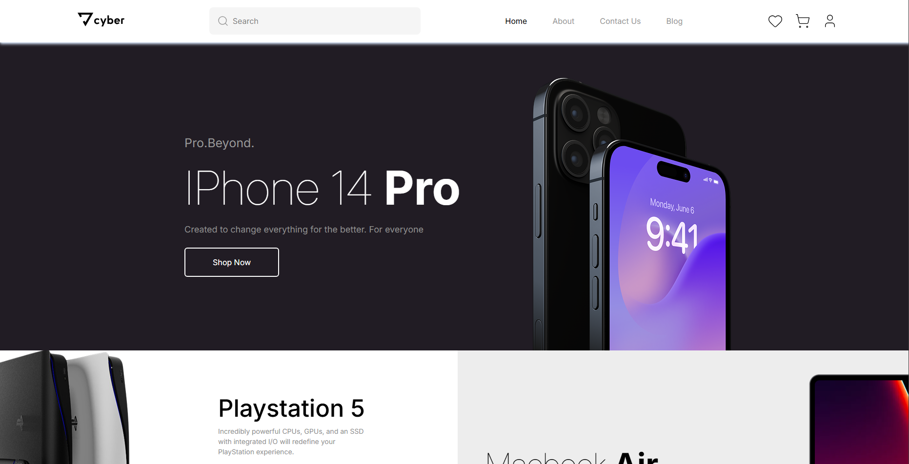

# 🛒 Cybertech Store

> **PT-BR:** E-commerce full-stack de tecnologia criado para estudo e portfólio.
>
> **EN:** Full-stack technology e-commerce project created for learning and portfolio purposes.



## Sobre / About

### Português

O Cybertech Store é uma loja de tecnologia responsiva construída com React e TypeScript. O projeto consome um catálogo externo de produtos, oferece autenticação de usuários, carrinho, lista de desejos, internacionalização e um assistente de IA focado na navegação e na escolha de produtos.

### English

Cybertech Store is a responsive technology shop built with React and TypeScript. The project consumes an external product catalog and provides user authentication, a shopping cart, a wishlist, internationalization, and an AI assistant focused on navigation and product discovery.

## Estado atual / Current status

- ✅ Layout responsivo mobile-first, header, footer, banners e categorias.
- ✅ Catálogo dinâmico por categoria usando DummyJSON.
- ✅ Página inicial, detalhes de produto, login, cadastro, perfil, carrinho e lista de desejos.
- ✅ Autenticação com JWT em cookie `httpOnly`, com rotas públicas e privadas.
- ✅ Persistência de carrinho e wishlist com Prisma e PostgreSQL.
- ✅ Idiomas English e Português (Brasil), com fallback local e integração opcional com Locize.
- ✅ Cybertech AI: recomenda produtos e orienta a navegação do site.
- 🚧 Checkout, pagamentos, pedidos e upload de foto de perfil ainda não fazem parte do backend atual.

## Tecnologias / Tech stack

**Frontend:** React, TypeScript, Vite, React Router, Tailwind CSS, Axios, i18next, react-i18next, Locize e Lucide.

**Backend:** Node.js, Express, TypeScript, Prisma, PostgreSQL, bcrypt, JSON Web Tokens e cookie-parser.

**AI:** endpoint compatível com OpenAI Chat Completions, configurado por variáveis de ambiente.

## Executando localmente / Running locally

### Pré-requisitos / Prerequisites

- Node.js 20+ recomendado / recommended.
- PostgreSQL disponível para o backend / available for the backend.

### Frontend

```bash
npm install
copy .env.example .env.local
npm run dev
```

O frontend usa `http://localhost:10000` como backend padrão. Para alterar, configure `VITE_API_URL`.

The frontend uses `http://localhost:10000` as the default backend URL. Set `VITE_API_URL` to change it.

### Backend

```bash
cd backend
npm install
```

Configure `DATABASE_URL`, `JWT_SECRET`, `FRONTEND_URL` e as variáveis opcionais do modelo no ambiente do backend. Em seguida, gere o cliente Prisma e inicie o servidor:

Configure `DATABASE_URL`, `JWT_SECRET`, `FRONTEND_URL`, and the optional model variables in the backend environment. Then generate the Prisma client and start the server:

```bash
npx prisma migrate deploy
npm run build
npm run dev
```

O backend escuta a porta `10000` por padrão (`PORT` pode alterá-la).

The backend listens on port `10000` by default (`PORT` can override it).

## Variáveis de ambiente / Environment variables

| Variável / Variable | Onde / Where | Finalidade / Purpose |
| --- | --- | --- |
| `VITE_API_URL` | Frontend | URL base da API / API base URL |
| `VITE_LOCIZE_PROJECT_ID` | Frontend | ID público do projeto Locize / public Locize project ID |
| `VITE_LOCIZE_VERSION` | Frontend | Versão do conteúdo Locize / Locize content version |
| `DATABASE_URL` | Backend | Conexão PostgreSQL / PostgreSQL connection |
| `JWT_SECRET` | Backend | Assinatura dos tokens JWT / JWT signing secret |
| `FRONTEND_URL` | Backend | Origem permitida pelo CORS / allowed CORS origin |
| `LLM_API_KEY` | Backend | Chave do provedor de IA / AI provider key |
| `LLM_BASE_URL` | Backend | Base da API compatível / compatible API base |
| `LLM_MODEL` | Backend | Modelo usado pelo assistente / assistant model |

Não publique segredos no frontend. `LLM_API_KEY`, `DATABASE_URL` e `JWT_SECRET` devem existir apenas no ambiente do backend.

Never expose secrets in the frontend. `LLM_API_KEY`, `DATABASE_URL`, and `JWT_SECRET` must only exist in the backend environment.

## Rotas / Routes

Frontend: `/`, `/product/:id`, `/login`, `/register`, `/profile`, `/cart` e `/wishlist`.

Backend: `/register`, `/login`, `/logout`, `/profile`, `/cart`, `/wishlist` e `/assistant/chat`.

Detalhes dos contratos HTTP estão em [`docs/endpoints.md`](docs/endpoints.md).

HTTP contract details are available in [`docs/endpoints.md`](docs/endpoints.md).

## Documentação / Documentation

| Documento / Document | Conteúdo / Contents |
| --- | --- |
| [`docs/1-planner.md`](docs/1-planner.md) | Objetivos, escopo e próximos passos / goals, scope, and next steps |
| [`docs/architecture.md`](docs/architecture.md) | Arquitetura do frontend e backend / frontend and backend architecture |
| [`docs/database-schema.md`](docs/database-schema.md) | Modelos Prisma / Prisma models |
| [`docs/endpoints.md`](docs/endpoints.md) | API REST e autenticação / REST API and authentication |
| [`docs/i18n-locize.md`](docs/i18n-locize.md) | Internacionalização / internationalization |
| [`docs/security-and-auth.md`](docs/security-and-auth.md) | Segurança e autenticação / security and authentication |
| [`docs/ui-ux-design.md`](docs/ui-ux-design.md) | Interface, responsividade e acessibilidade / UI, responsiveness, and accessibility |
| [`docs/challenges-and-learnings.md`](docs/challenges-and-learnings.md) | Decisões, aprendizados e limitações / decisions, learnings, and limitations |

## 🌐 Preview

Referência visual no Figma: [E-Store — Mobile web](https://www.figma.com/design/5ShWzeXmTChbGMLHAcSocJ/E-Store---Mobile-web--Community-?node-id=91-75&t=ZcVUk93YZsdnbVhy-0).

Live project: [Ecommerce Cybertech](https://ecommerce-project-omega-hazel.vercel.app).

## Autora / Author

<a>
<br />
<sub><b>Andressa Martins</b></sub></a>

Made by Andressa Martins. Feel free to get in touch <3.

<a href="mailto:andressa.devsystem@gmail.com"></a>